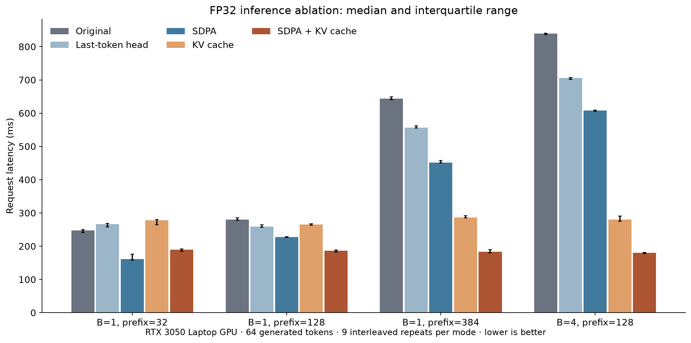

# Environmental Language Model

A 25.3M-parameter decoder-only Transformer built in PyTorch, with a checkpoint-compatible inference engine and measured attention/cache ablations. The original model was trained from scratch on IPCC and UNEP text.

## Measured inference

FP32 on an RTX 3050 Laptop GPU, generating 64 tokens. Median of nine interleaved measurements after two warmups per mode:

| Batch | Prefix tokens | Original request | SDPA + cache + last-token head | Speedup |
| ---: | ---: | ---: | ---: | ---: |
| 1 | 32 | 247.76 ms | 189.84 ms | 1.31x |
| 1 | 128 | 279.81 ms | 186.23 ms | 1.50x |
| 1 | 384 | 643.43 ms | 183.54 ms | 3.51x |
| 4 | 128 | 839.79 ms | 180.28 ms | 4.66x |

All measured greedy token sequences match the original implementation within the same precision. Short prompts do not always benefit from adding a cache. Memory includes a persistent KV payload, so faster execution does not imply lower peak allocation. These are fixed-workload synthetic-token measurements, not answer-quality scores or server benchmarks.



[Full timings and memory](results/PERFORMANCE.md) · [Raw measurements](results/performance.csv) · [Design](ENGINEERING.md) · [Portfolio wording](PORTFOLIO.md)

## Generate with the upgraded engine

```bash
python src/inference.py --checkpoint checkpoints/finetuned_model.pt --question "What is climate change?"
```

The engine supports manual attention or PyTorch SDPA, request-local per-layer KV caches, multi-token cache updates and last-position vocabulary projection. It keeps the original weights and parameter names. Learned absolute positions are preserved; when the 512-token window slides, caches are rebuilt rather than reusing stale positions. Equal-length batching is supported; padded variable-length batches and continuous batching are not implemented.

Use `--backend manual` to inspect the reference attention path, or `--no-cache` to disable caching. Generation is greedy and uses the training-style BOS token. The legacy sampling interfaces remain available below.

## What the old quality numbers support

The available data has 13 training QA pairs and 3 validation pairs. Re-evaluation on those same three pairs reduces token-weighted answer loss from 6.4683 to 5.4034; teacher-forced token match rises from 7.25% to 20.29%, including EOS. This is validation-set reproduction, not an independent QA accuracy estimate.

[The audit](results/AUDIT.md) includes hashes, denominators and actual generated answers. The checkpoint remains a limited language model: improving execution speed does not improve its knowledge.

## Model

About 25.3M parameters: 6 pre-LayerNorm blocks, 8 attention heads, a hidden size of 512 and a feed-forward size of 2,048. The context window is 512 tokens. Token and position embeddings are learned; input and output token weights are tied. The ByteLevel BPE vocabulary has 12,000 tokens.

Model settings are in `src/config.py`; the Transformer is in `src/model.py`.

## Setup

Originally developed with Python 3.11. The inference upgrade was tested with Python 3.12 and PyTorch 2.11. CUDA is recommended for training and GPU benchmarking; CPU correctness tests are supported.

```bash
python -m pip install -r requirements.txt
```

Run the commands below from the repository root.

## Training

Place PDF reports in `data/raw/`, then extract the text into `data/processed/`:

```bash
python src/prepare_corpus.py
```

A trained tokenizer is included as `tokenizer.json`. To retrain it on your corpus:

```bash
python src/train_tokenizer.py
```

Pre-train the model:

```bash
python src/train.py
```

Training uses AdamW, gradient clipping and mixed precision on CUDA. Checkpoints go to `checkpoints/`; loss history goes to `results/base_training_history.json`. Training settings are at the top of `src/train.py`.

New pretraining runs purge overlapping windows at the train/validation boundary. For the original corpus this removes two windows. The historical checkpoint used the earlier split, which shared 256 target-token positions across the boundary. Purging fixes direct token-position overlap in future runs; it does not establish unseen-document generalization. The tokenizer should also be trained on a document-level training partition for a stronger new quality study.

For question-answer fine-tuning, use `data/finetune/train.jsonl` and `validation.jsonl`, with one pair per line:

```json
{"question": "What is climate change?", "answer": "Climate change is a long-term change in climate patterns."}
```

```bash
python src/finetune.py
```

Only answer tokens contribute to the fine-tuning loss. The script loads `checkpoints/base_model_epoch_1.pt` and saves `checkpoints/finetuned_model.pt`. Adjust the paths in `src/finetune.py` if needed.

## Generation

Generate text from the base model:

```bash
python src/generate.py
```

Start the fine-tuned question-answer interface:

```bash
python src/chat.py
```

Generation uses temperature and top-k sampling. Type `quit` to exit the chat.

## Data and limitations

The source PDFs, extracted corpus and model checkpoints are not included. The repository contains the tokenizer, a small question-answer dataset and training loss history.

Responses can be repetitive or incorrect. The upgrade adds reproducible measurement and fixes future split handling; it does not retrain the original checkpoints or establish reliable environmental question answering.

## Checks and measurement

```bash
python -m unittest discover -s tests -v
python verify_results.py
python audit_model.py --checkpoint-dir checkpoints --corpus-dir data/processed
python check_optimization.py --checkpoint-dir checkpoints
python benchmark_inference.py --checkpoint checkpoints/finetuned_model.pt --output results/benchmark_fp32.json
python benchmark_inference.py --checkpoint checkpoints/finetuned_model.pt --precision float16 --output results/benchmark_fp16.json
python profile_attention.py --checkpoint checkpoints/finetuned_model.pt
python -m pip install -r requirements-analysis.txt
python make_results.py
```

The first two commands run without checkpoint files. The remaining model commands require the original local weights; the audit's corpus analysis also needs the original extracted text. Published JSON files preserve the measured results and checkpoint identities. Profiling records actual SDPA operator dispatch separately from timing. Ten CPU tests cover original-logit equivalence, cached causal offsets, future-token isolation, gradient equivalence, request isolation, position-window rollover and purged data splits. Thirty-two additional trained-checkpoint logit comparisons are saved under `results/`.

Related projects: [CMU AG News](https://github.com/Yulin2628/cmu-ag-news) and [AI Buyer Assistant](https://github.com/Yulin2628/ai-buyer-assistant).
