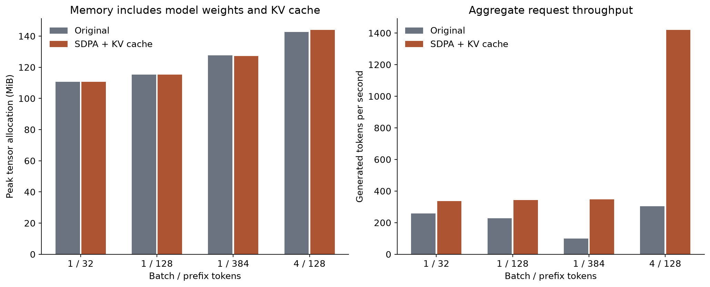

# Inference measurements

Device: NVIDIA GeForce RTX 3050 Laptop GPU. PyTorch 2.11.0+cu128; 4 CPU threads.

Each request generates exactly 64 tokens from fixed synthetic token IDs. EOS stopping is disabled so all modes do equal work. CUDA is synchronized at phase boundaries. Two warmup requests precede nine measured requests per mode; mode order is randomized within each repeat. The allocator remains warm. Model loading, tokenization and profiling are outside timing. All modes use the same fine-tuned checkpoint. These are local batch-request measurements, not concurrent-server latency or quality scores.

## FP32 ablations

| Batch | Prefix | Mode | Median request (ms) | TTFT (ms) | Decode tokens/s | Peak allocated (MiB) | Speedup | Same greedy IDs |
| ---: | ---: | --- | ---: | ---: | ---: | ---: | ---: | --- |
| 1 | 32 | original | 247.76 | 4.93 | 258.7 | 110.77 | 1.00x | True |
| 1 | 32 | manual_last | 266.92 | 5.02 | 240.7 | 109.12 | 0.93x | True |
| 1 | 32 | sdpa_last | 160.86 | 2.86 | 398.7 | 108.84 | 1.54x | True |
| 1 | 32 | manual_cache | 277.97 | 5.22 | 233.4 | 110.73 | 0.89x | True |
| 1 | 32 | sdpa_cache | 189.84 | 3.88 | 338.6 | 110.72 | 1.31x | True |
| 1 | 128 | original | 279.81 | 5.70 | 229.5 | 115.36 | 1.00x | True |
| 1 | 128 | manual_last | 258.69 | 4.96 | 248.2 | 113.88 | 1.08x | True |
| 1 | 128 | sdpa_last | 227.07 | 3.44 | 282.0 | 112.35 | 1.23x | True |
| 1 | 128 | manual_cache | 265.34 | 4.47 | 242.4 | 115.23 | 1.05x | True |
| 1 | 128 | sdpa_cache | 186.23 | 3.47 | 344.9 | 115.22 | 1.50x | True |
| 1 | 384 | original | 643.43 | 8.49 | 99.2 | 127.58 | 1.00x | True |
| 1 | 384 | manual_last | 557.04 | 7.67 | 114.7 | 129.10 | 1.16x | True |
| 1 | 384 | sdpa_last | 451.67 | 6.13 | 141.3 | 118.86 | 1.42x | True |
| 1 | 384 | manual_cache | 286.77 | 7.54 | 226.5 | 131.14 | 2.24x | True |
| 1 | 384 | sdpa_cache | 183.54 | 6.18 | 355.4 | 127.23 | 3.51x | True |
| 4 | 128 | original | 839.79 | 9.17 | 303.5 | 142.72 | 1.00x | True |
| 4 | 128 | manual_last | 705.36 | 8.05 | 361.5 | 133.19 | 1.19x | True |
| 4 | 128 | sdpa_last | 608.52 | 6.87 | 419.0 | 128.04 | 1.38x | True |
| 4 | 128 | manual_cache | 279.77 | 8.17 | 926.8 | 144.02 | 3.00x | True |
| 4 | 128 | sdpa_cache | 180.28 | 6.84 | 1454.2 | 143.99 | 4.66x | True |




Memory uses torch.cuda.max_memory_allocated, including parameters and transient tensors; it excludes reserved allocator blocks, CUDA context and other applications. Cache payload bytes are also recorded separately in the raw files. SDPA dispatch can differ by dtype and GPU; attention_dispatch.json records observed operators. This integrates PyTorch's kernels and does not implement a custom CUDA kernel.

Caching is not universally faster: small requests can be dominated by Python dispatch and allocation overhead. Compare sdpa_last with sdpa_cache to isolate the added cache under the same attention backend. Compare original with manual_last to estimate the last-position projection change; minor decoder-wrapper and mask-construction differences also contribute. Compare manual_last with sdpa_last to isolate the attention backend. The combined speedup must not be attributed entirely to KV caching.

## Numerical checks

32 trained-checkpoint checks compare full and cached logits against the original forward pass, using both saved checkpoints, two precisions and four batch/length cases. All passed: True. The maximum permitted absolute error is 0.0003 for FP32 and 0.05 for FP16; actual errors and token-level top-1 agreement are preserved in optimization_checks.json. Finite-precision ties can change decisions, so tolerance checks and generated-ID equality are reported separately. CPU regression tests also cover causal isolation, all-parameter gradients, request isolation and context rollover.

## FP16 diagnostic run

| Batch | Prefix | Original request (ms) | Optimized request (ms) | Within-FP16 speedup | Same greedy IDs |
| ---: | ---: | ---: | ---: | ---: | --- |
| 1 | 32 | 999.10 | 729.99 | 1.37x | True |
| 1 | 128 | 833.43 | 643.10 | 1.30x | True |
| 1 | 384 | 943.67 | 713.18 | 1.32x | True |
| 4 | 128 | 968.90 | 681.81 | 1.42x | True |

FP32 and FP16 were measured in separate laptop sessions. Their absolute timing difference is not a controlled estimate of the effect of precision. Neither run supports a universal half-precision speedup. Each mode comparison within a run is interleaved, but CPU/GPU clocks, thermal state, background load and scheduling can still vary. Nine repetitions of one checkpoint and one device do not establish performance across deployments.

## Reproduce

```bash
python benchmark_inference.py --checkpoint checkpoints/finetuned_model.pt --output results/benchmark_fp32.json
python benchmark_inference.py --checkpoint checkpoints/finetuned_model.pt --precision float16 --output results/benchmark_fp16.json
python check_optimization.py --checkpoint-dir checkpoints
python profile_attention.py --checkpoint checkpoints/finetuned_model.pt
python -m pip install -r requirements-analysis.txt
python make_results.py
python verify_results.py
```

Sources: [PyTorch SDPA](https://docs.pytorch.org/docs/2.11/generated/torch.nn.functional.scaled_dot_product_attention.html). The original parameterization and weights are unchanged.
